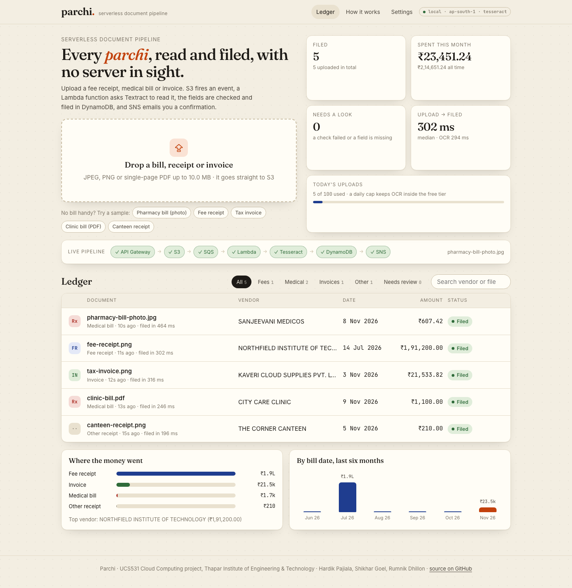
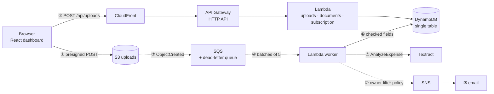
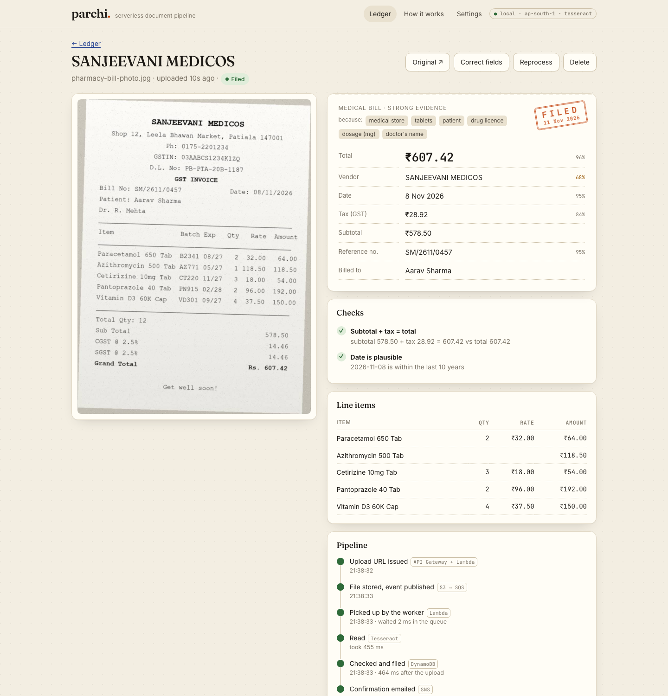
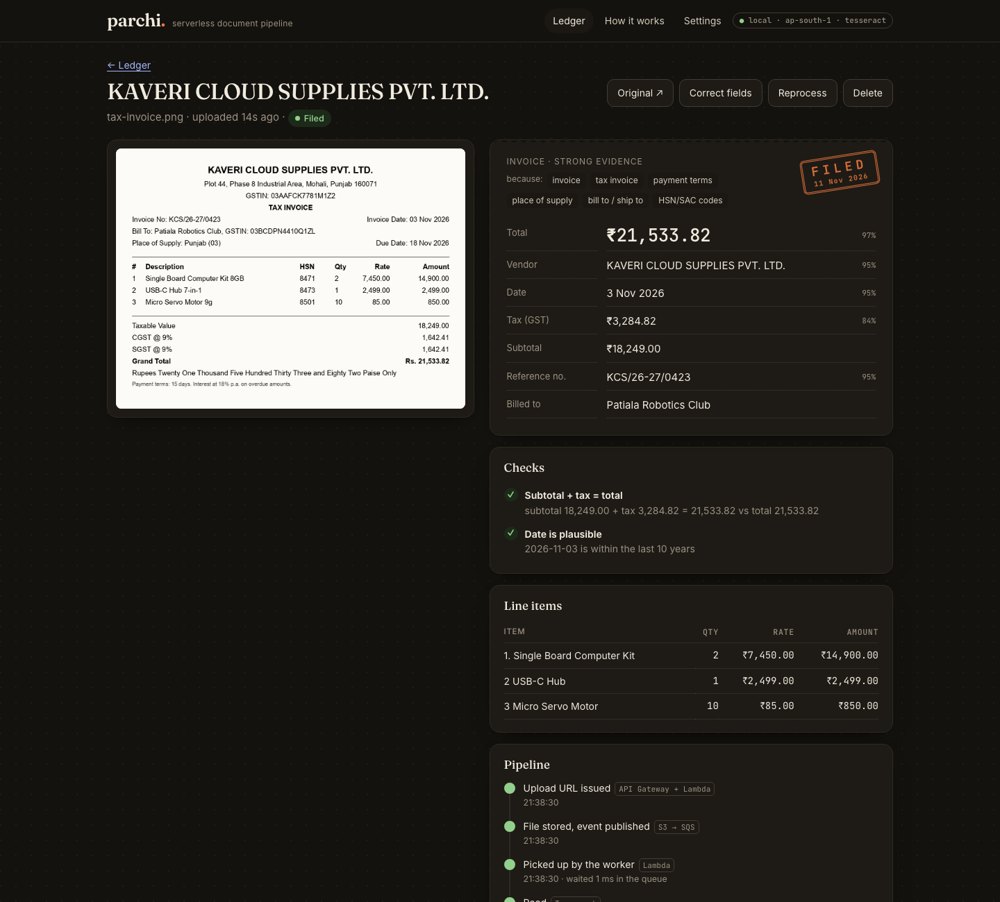

# 🧾 Parchi — serverless, event-driven document processing on AWS

*Parchi (पर्ची) means a slip of paper in Hindi: the fee receipt, pharmacy bill or invoice everyone keeps in a drawer.*

[](https://github.com/pajiala99/parchi/actions/workflows/ci.yml)

UCS531 Cloud Computing project · Thapar Institute of Engineering & Technology, Patiala.

Upload a bill and a chain of managed AWS services reads it, checks it, files it and emails you a confirmation.
**No server exists at any point**: S3 fires an event, SQS queues it, a Lambda function reads the bill with Amazon
Textract, DynamoDB files the result and SNS sends the email. Everything is infrastructure as code in one
[`template.yaml`](template.yaml).

**Try it in one command, no AWS account needed:** `scripts/demo.sh` runs the same Lambda code against an AWS
emulator and opens the dashboard ([details](#run-it-locally)).



*Five sample bills filed in the offline stack: each went browser → S3 → SQS → Lambda → OCR → DynamoDB → SNS in under half a second.*

`AWS Lambda` · `API Gateway` · `S3` · `SQS` · `DynamoDB` · `Amazon Textract` · `SNS` · `CloudFront` · `CloudWatch` · `AWS SAM` · `Python 3.13` · `React 19` · `TypeScript` · `moto` · `pytest` · `GitHub Actions`

What it covers, end to end:

- **Event-driven serverless architecture**: presigned uploads straight to S3, S3 → SQS → Lambda, nothing running between events
- **Reliability**: idempotent processing under at-least-once delivery, per-message retries, a dead-letter queue with alarms
- **Real document understanding for Indian bills**: lakh-grouped rupees, CGST + SGST, GSTIN checksums, totals that must reconcile, an explainable fee-receipt / medical-bill / invoice classifier
- **Security and cost controls**: least-privilege IAM per function, private encrypted buckets, daily upload caps in a DynamoDB transaction, a budget alert
- **Observability**: custom CloudWatch metrics (Embedded Metric Format), a dashboard and four alarms
- **A dashboard you can watch**: every document's position in the pipeline, live, with per-stage timings
- **118 automated tests**, including an end-to-end run over real HTTP through an AWS emulator, and CI on every push

---

## Architecture



1. **Ask for an upload URL.** A Lambda function validates type, size and the daily quota, writes a *waiting* record and returns a **presigned S3 POST** that S3 itself enforces (content type, ≤ 10 MB, exact key).
2. **Upload straight to S3.** The file never passes through API Gateway or Lambda: no payload limit, no compute billed for transfers.
3. **S3 fires an event** into an **SQS queue** that buffers bursts and retries failures; after three failed attempts the event moves to a **dead-letter queue** and an alarm fires.
4. **Lambda scales with the queue**: batches of up to five, at most five copies at once, which keeps Textract under its request quota.
5. **Textract AnalyzeExpense** returns vendor, date, totals, tax lines and line items with confidences; Parchi picks the right candidates (Grand Total over "Total Qty", CGST + SGST added up).
6. **Checked and filed**: GSTIN mod-36 checksum, subtotal + tax = total, a plausible date; anything doubtful is flagged for review. One conditional write files it in DynamoDB.
7. **SNS emails you.** One topic serves everyone; each subscription has a **filter policy** on the `owner` message attribute, so you only get your own confirmations.

CloudFront serves the dashboard from a private S3 bucket (Origin Access Control) and routes `/api/*` to API Gateway on the same domain, so the browser never makes a cross-origin API call.

| | |
|---|---|
|  |  |
| *A noisy phone photo of a pharmacy bill: every field with its OCR confidence, why it was classified as a medical bill, the checks it passed and how long each stage took.* | *Dark mode, a GST tax invoice: CGST + SGST added up and the GSTIN checksum verified.* |

## AWS services

| Service | Role | Why this one |
|---|---|---|
| **S3** | uploads (private, SSE, TLS-only) and the dashboard site | presigned POSTs push policy enforcement to S3 itself |
| **SQS** + DLQ | buffers upload events, retries, dead letters | decouples bursts from Textract's quota; nothing is lost |
| **Lambda** (Python 3.13, arm64) | 3 API functions + 1 worker | pay per request; Graviton costs less per GB-second |
| **API Gateway** HTTP API | 11 routes, throttled, JSON access logs | cheaper and simpler than REST APIs for this use |
| **Textract** AnalyzeExpense | reads receipts and invoices | purpose-built for bills: totals, tax, line items |
| **DynamoDB** on-demand | documents, profiles, daily quotas (TTL) | single-table design; conditional writes give idempotency |
| **SNS** | confirmation emails | filter policies give per-user delivery from one topic |
| **CloudFront** | HTTPS, caching, one origin for site + API | edge locations in India (PriceClass_200) |
| **IAM** | one least-privilege role per function | each function can do only what it needs |
| **CloudWatch** | EMF custom metrics, dashboard, 4 alarms, log retention | observability without extra API calls |
| **Budgets** | monthly cost alert (optional) | "set a billing alarm on day one" |

`template.yaml` (AWS SAM, ~45 resources after the transform) passes `cfn-lint` and `sam validate --lint`, and `sam build` succeeds.

## Results

| | |
|---|---|
| **Upload → filed** (offline stack, Tesseract OCR) | 0.2 – 0.5 s per bill; median ≈ 0.4 s |
| **Fields read correctly** (6 synthetic bills × 6 fields, Tesseract) | 36 / 36: type, vendor, date, reference, total, tax |
| **Hardest sample** | a tilted, blurred, noisy phone photo of a pharmacy bill: all 6 fields correct |
| **Backend tests** | 118, 93% coverage, including an end-to-end run over HTTP |
| **Cost** | ≈ $10 per 1,000 documents (~99% Textract); ≈ $0 while idle |

The accuracy figure is a smoke test, not a benchmark: the samples are synthetic and the heuristics were written
against them. Textract's own accuracy can be measured once the stack is deployed. Run `local/evaluate.py` to
reproduce the table.

## Engineering decisions worth talking about

- **Event-driven, not request-driven.** The API only hands out upload URLs and reads results; the heavy work happens off the request path, triggered by S3 → SQS. A slow Textract call never times out a browser request.
- **Why a queue between S3 and Lambda.** S3 can invoke Lambda directly, but Textract accepts only a few requests per second. SQS absorbs bursts, retries with a delay and keeps failures in a dead-letter queue instead of dropping them; Lambda's event source mapping scales workers with the queue, capped at five.
- **Idempotent processing.** SQS delivers at least once. The worker claims a document with a conditional write and a lease (`leaseUntil`), so a duplicate delivery finds it filed or in progress and is skipped. Failures are reported per message (`ReportBatchItemFailures`), so one bad file never makes SQS redeliver the good ones.
- **Permanent vs transient errors.** An unreadable file fails at once with a reason (and an email). Throttling and service errors are retried; on the last attempt the document is marked failed and the event lands in the alarmed dead-letter queue.
- **Cost guard rails.** Daily upload caps per workspace and for the whole deployment, enforced atomically by a DynamoDB transaction; the worker's concurrency is capped; an optional monthly budget alert.
- **Explainable output.** The classifier is weighted keyword evidence and shows *why* ("pharmacy, tablets, drug licence"). Every field carries its OCR confidence; failed checks put the document in "needs review"; users can correct fields, and corrections are tracked.
- **One domain, no CORS, no circular dependencies.** CloudFront serves the site and the API. The upload bucket's name is built with `!Sub`, so the functions never reference the bucket resource (its CORS rule references CloudFront, which fronts the API, which depends on the functions).
- **The template and the code can't drift.** A test reads `template.yaml` and checks that every route is implemented, and that retry counts, timeouts and the S3 prefix agree with the code; the local stack reads its routes from the same file.

## Security model

- Buckets block all public access, encrypt at rest and deny non-TLS requests; the site bucket answers only this CloudFront distribution.
- Presigned POSTs expire after 5 minutes and pin the object key, content type and size range.
- Each Lambda function has its own IAM role scoped to the table, the `uploads/` prefix, the queue or the topic it uses.
- **Workspaces, not accounts.** The browser generates a random 256-bit key and sends it as `X-Parchi-Key`; the server stores only a hash of it, and every query is scoped to that hash (pagination cursors are checked so they can't cross workspaces). Anyone with the key or the "open on another device" link sees that workspace. Production would put a **Cognito user pool with an API Gateway JWT authorizer** in front: a configuration change, not a redesign.

## Run it locally

[`scripts/demo.sh`](scripts/demo.sh) runs the **same Lambda handlers** against [moto](https://github.com/getmoto/moto), which emulates S3, SQS, SNS and DynamoDB. The bucket really sends `ObjectCreated` events to the queue, a poller thread plays the Lambda event source mapping, routes are read from `template.yaml`, and emails land in an outbox shown in Settings. OCR uses **Tesseract** if it's installed, or replays simulated Textract responses for the sample bills.

```bash
brew install tesseract      # optional: real OCR for any bill (without it, the sample bills still work)
scripts/demo.sh             # sets up on first run, builds, starts and opens http://localhost:3001
```

Needs Python 3.12+ and Node.js 20+. For development with live reload, run `.venv/bin/python local/devstack.py` and `cd frontend && npm run dev` (http://localhost:5173).

## Deploy to AWS

Needs the AWS CLI, the SAM CLI, Node.js and credentials. Step by step, including AWS Academy Learner Lab: [docs/DEPLOY.md](docs/DEPLOY.md).

```bash
scripts/deploy.sh -e you@example.com                # stage "dev" in ap-south-1 (Mumbai), with alarm and budget emails
scripts/deploy.sh -r us-east-1 --lambda-role arn:aws:iam::<account>:role/LabRole   # AWS Academy Learner Lab
scripts/teardown.sh                                 # delete everything
```

> **Status:** not deployed yet. The AWS Academy labs available to us are per-lesson sandboxes that block most of these services, so the project is demonstrated with the offline stack, which runs the identical handler code.

## Tests

```bash
.venv/bin/pytest            # 118 backend tests
cd frontend && npm test     # dashboard tests; npm run build type-checks
```

- **Parsers:** Indian money and dates, GSTIN checksums, the classifier, Textract response handling (including the "Total Qty" decoy and CGST + SGST), the OCR heuristics and the cross-checks.
- **API:** every route against moto: validation, quotas (both counters move together or not at all), pagination and cursor tampering, workspace isolation, corrections, reprocessing, deletion, statistics, SNS filter policies (including two workspaces sharing one email).
- **Worker:** success, duplicate deliveries, leases, permanent and transient failures, the last-attempt path, S3 test events, foreign keys, deletion during processing.
- **End to end:** a moto server over real HTTP: browser-style presigned POST → S3 notification → SQS → worker → DynamoDB → SNS delivered only to the right owner.
- **Template parity:** routes, retry counts, timeouts and the S3 prefix agree between `template.yaml` and the code.

CI (GitHub Actions) runs ruff, cfn-lint, pytest and the frontend tests and build on every push.

## Documents

| | |
|---|---|
| [docs/REPORT.md](docs/REPORT.md) · [PDF](docs/REPORT.pdf) | the course report: problem, cloud concepts, architecture, reliability, security, cost, testing |
| [docs/DEMO.md](docs/DEMO.md) | a 5-minute demo script for the viva, with answers to likely questions |
| [docs/DEPLOY.md](docs/DEPLOY.md) | deployment, AWS Academy notes, troubleshooting, teardown |

## Project layout

```
template.yaml          AWS SAM: the whole stack
backend/src/parchi/    Lambda code: handlers/, extraction/, engines/ (textract, tesseract, replay), store, notify
backend/tests/         pytest suite (moto, botocore Stubber, end to end over HTTP)
frontend/              React + TypeScript + Vite dashboard (no UI kit)
local/                 devstack.py (offline AWS), make_samples.py, evaluate.py
samples/               synthetic bills, ground truth, simulated Textract responses
scripts/               demo.sh (offline demo), deploy.sh, teardown.sh
docs/                  REPORT.md + PDF, DEMO.md, DEPLOY.md, architecture.png, screenshots/
```

The sample bills in [`samples/`](samples) and their Textract responses are **synthetic**: rendered by `local/make_samples.py` with fictional names and GSTINs; the responses follow the documented AnalyzeExpense shape but were not recorded from AWS.

## AI tools used

- **Claude Code** (Anthropic's coding agent, Claude Opus 5.5) helped write the code, tests and documentation, working from our project proposal.

## Limitations and next steps

- **Deploy it** with a Learner Lab or a personal account and measure Textract on real bills.
- Textract's synchronous API reads one page; multi-page PDFs need `StartExpenseAnalysis` with an SNS completion notification.
- Workspace keys instead of accounts; Cognito is the production answer.
- The dashboard polls; API Gateway WebSockets would push updates instead.
- The classifier is rule-based; with labelled data it could become Amazon Comprehend custom classification.

## Team

**Hardik Pajiala** ([@pajiala99](https://github.com/pajiala99)) · **Shikhar Goel** ([@sgoel2be24-cyber](https://github.com/sgoel2be24-cyber)) · **Rumnik Dhillon**
Faculty advisor: Dr. Anil Singh · UCS531 Cloud Computing, Thapar Institute of Engineering & Technology

## License

MIT — see [LICENSE](LICENSE).

---

[LinkedIn](https://linkedin.com/in/hardik-pajiala) · [Portfolio](https://pajiala99.github.io) · [GitHub](https://github.com/pajiala99)
