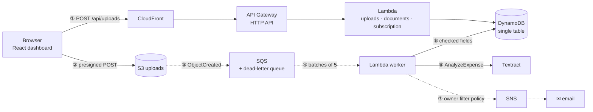

# Parchi — serverless, event-driven document processing on AWS

[](https://github.com/pajiala99/parchi/actions/workflows/ci.yml)

*Parchi* (पर्ची) is Hindi for a slip of paper: the fee receipt, pharmacy bill or invoice everyone keeps in a drawer.
Upload one and a chain of managed AWS services reads it, checks it, files it and emails you a confirmation.
**No server exists at any point** — every step runs because an event arrived.

> UCS531 Cloud Computing project · Thapar Institute of Engineering & Technology, Patiala ·
> Hardik Pajiala ([@pajiala99](https://github.com/pajiala99)), Shikhar Goel ([@sgoel2be24-cyber](https://github.com/sgoel2be24-cyber)), Rumnik Dhillon ·
> Faculty advisor: Dr. Anil Singh


## How it works



1. **Ask for an upload URL.** A Lambda function validates type, size and the daily quota, writes a *waiting* record and returns a **presigned S3 POST** that S3 itself enforces (content type, ≤ 10 MB).
2. **Upload straight to S3.** The file never passes through API Gateway or Lambda: no 6 MB payload limit, no compute billed for transfers.
3. **S3 fires an event** into an **SQS queue** that buffers bursts and retries failures; after three failed attempts the event moves to a **dead-letter queue** and an alarm fires.
4. **Lambda scales with the queue**: batches of up to five, at most five copies at once — enough to keep Textract under its request quota.
5. **Textract AnalyzeExpense** returns vendor, date, totals, tax lines and line items with confidences; Parchi picks the right candidates (Grand Total over "Total Qty", CGST + SGST added up).
6. **Checked and filed**: GSTIN mod-36 checksum, subtotal + tax = total, a plausible date. Anything doubtful is flagged for review. One conditional write files it in DynamoDB.
7. **SNS emails you.** One topic serves everyone; each subscription has a **filter policy** on the `owner` message attribute, so you only get your own confirmations.

CloudFront serves the dashboard from a private S3 bucket (Origin Access Control) and routes `/api/*` to API Gateway on the same domain, so the browser never makes a cross-origin API call.

| | |
|---|---|
|  |  |

## AWS services

| Service | Role | Why this one |
|---|---|---|
| **S3** | uploads (private, SSE, TLS-only) and the dashboard site | presigned POSTs push policy enforcement to S3 itself |
| **SQS** + DLQ | buffers upload events, retries, dead letters | decouples bursts from Textract's quota; nothing is lost |
| **Lambda** (Python 3.13, arm64) | 3 API functions + 1 worker | pay per request; Graviton costs less per GB-second |
| **API Gateway** HTTP API | 11 routes, throttled, JSON access logs | cheaper and simpler than REST APIs for this use |
| **Textract** AnalyzeExpense | reads receipts and invoices | purpose-built for bills: totals, tax, line items |
| **DynamoDB** on-demand | documents, profiles, daily quotas (TTL) | single-table design; conditional writes give idempotency |
| **SNS** | confirmation emails | filter policies give per-user delivery from one topic |
| **CloudFront** | HTTPS, caching, one origin for site + API | edge locations in India (PriceClass_200) |
| **IAM** | one least-privilege role per function | each function can do only what it needs |
| **CloudWatch** | EMF custom metrics, dashboard, 4 alarms, log retention | observability without extra API calls |
| **Budgets** | monthly cost alert (optional) | "set a billing alarm on day one" |

Everything is defined as code in [`template.yaml`](template.yaml) (AWS SAM). It passes `cfn-lint` and `sam validate --lint`, and `sam build` succeeds.

## Design decisions

- **Event-driven, not request-driven.** The API only hands out upload URLs and reads results; the heavy work happens off the request path, triggered by S3 → SQS. A slow Textract call never times out a browser request.
- **Idempotent processing.** SQS delivers at least once. The worker claims a document with a conditional write and a lease (`leaseUntil`), so a duplicate delivery finds it filed or in progress and is skipped. Failures are reported per message (`ReportBatchItemFailures`), so one bad file never makes SQS redeliver the good ones.
- **Permanent vs transient errors.** An unreadable file fails at once with a reason (and an email). Throttling and service errors are retried by SQS; on the last attempt the document is marked failed and the event lands in the dead-letter queue, which is alarmed.
- **Cost guard rails.** Daily upload caps per workspace and for the whole deployment, enforced atomically with a DynamoDB transaction; the worker's concurrency is capped; optional monthly budget alert.
- **Explainable output.** The classifier (fee receipt / medical bill / invoice / other) is weighted keyword evidence and shows *why* ("pharmacy, tablets, drug licence"). Every field carries its OCR confidence; failed checks put the document in "needs review"; users can correct fields, and corrections are tracked.
- **No CORS for the API, no circular dependencies.** One CloudFront domain serves both. The upload bucket's name is built with `!Sub` so the functions never reference the bucket resource (its CORS rule references CloudFront, which fronts the API, which depends on the functions).

## Security model

- Buckets block all public access, encrypt at rest and deny non-TLS requests; the site bucket only answers this CloudFront distribution.
- Presigned POSTs expire after 5 minutes and pin the object key, content type and size range.
- Each Lambda function has its own IAM role scoped to the table, the `uploads/` prefix, the queue or the topic it uses.
- **Workspaces, not accounts.** The browser generates a random 256-bit key and sends it as `X-Parchi-Key`; the server stores only a hash of it, and every query is scoped to that hash (list cursors are checked so they can't cross workspaces). Anyone holding the key or the "open on another device" link can see that workspace. For production you would put a **Cognito user pool with an API Gateway JWT authorizer** in front — a configuration change, not a redesign.

## Cost

About **$10 per 1,000 documents**, and ~99% of that is Textract ($0.01 per page). Lambda, API Gateway, S3, SQS, DynamoDB, SNS and CloudFront together come to about 10 cents. With nothing uploaded, the stack costs nothing but a few cents of storage. (Approximate on-demand list prices, late 2026; the "How it works" page in the app has the breakdown.)

## Run it locally (no AWS account)

[`local/devstack.py`](local/devstack.py) runs the **same Lambda handlers** against [moto](https://github.com/getmoto/moto), which emulates S3, SQS, SNS and DynamoDB. The bucket really sends `ObjectCreated` events to the queue, a poller thread plays the Lambda event source mapping, routes are read from `template.yaml`, and emails land in an outbox shown in Settings. OCR uses **Tesseract** if installed, or replays simulated Textract responses for the sample bills.

```bash
python3.13 -m venv .venv && .venv/bin/pip install -r backend/requirements-dev.txt
brew install tesseract                      # optional, for real OCR offline
.venv/bin/python local/devstack.py          # API on :3001, emulated AWS on :5055
cd frontend && npm install && npm run dev   # http://localhost:5173 — try the sample bills
```

## Deploy to AWS

Needs the AWS CLI, the SAM CLI, Node.js and credentials. Details in [docs/DEPLOY.md](docs/DEPLOY.md).

```bash
scripts/deploy.sh                                   # stage "dev" in ap-south-1 (Mumbai)
scripts/deploy.sh -e you@example.com                # plus alarm and budget emails
scripts/deploy.sh -r us-east-1 --lambda-role arn:aws:iam::<account>:role/LabRole   # AWS Academy Learner Lab
scripts/teardown.sh                                 # delete everything
```

> **Status:** not deployed yet — it was built on a machine without AWS credentials. Everything up to the AWS API boundary is tested offline.

## Tests and evaluation

- **Backend:** `.venv/bin/pytest` — 118 tests, 93% coverage: parsers (Indian money and dates, GSTIN), Textract response handling, every API route against moto, the worker's retry/idempotency/failure paths, a **template ↔ code parity test**, and an **end-to-end run over real HTTP** against a moto server: browser-style presigned POST → S3 event → SQS → worker → DynamoDB → owner-filtered SNS delivery.
- **Frontend:** `cd frontend && npm test` — formatting, routing and API client tests; `npm run build` type-checks.
- **CI:** GitHub Actions runs ruff, cfn-lint, pytest and the frontend tests and build on every push.
- **OCR accuracy (offline engine):** [`local/evaluate.py`](local/evaluate.py) scores Tesseract + Parchi's heuristics on six synthetic bills (fee receipt, pharmacy bill, tax invoice, clinic PDF, canteen receipt, and a tilted, noisy phone photo): **36/36 fields** correct (type, vendor, date, reference, total, tax). The heuristics were tuned on these same samples, so treat this as a smoke test, not a benchmark. Textract itself can only be measured once deployed.

The sample bills in [`samples/`](samples) and their Textract responses are **synthetic**: rendered by `local/make_samples.py`, with fictional names and GSTINs; the responses follow the documented AnalyzeExpense shape but were not recorded from AWS.

## Repository

```
template.yaml          AWS SAM: the whole stack
backend/src/parchi/    Lambda code: handlers/, extraction/, engines/ (textract, tesseract, replay), store, notify
backend/tests/         pytest suite (moto, botocore Stubber, end-to-end over HTTP)
frontend/              React + TypeScript + Vite dashboard (no UI kit)
local/                 devstack.py, make_samples.py, evaluate.py
samples/               synthetic bills, ground truth, simulated Textract responses
scripts/               deploy.sh, teardown.sh
docs/                  REPORT.md (course report), DEPLOY.md, screenshots/
```

## License

MIT — see [LICENSE](LICENSE).

---

[LinkedIn](https://linkedin.com/in/hardik-pajiala) · [Portfolio](https://pajiala99.github.io) · [GitHub](https://github.com/pajiala99)
