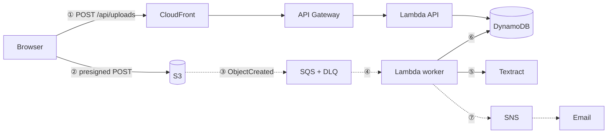

# Serverless Event-Driven Document Processing Pipeline on AWS

**Project report — UCS531 Cloud Computing**
Department of Computer Science and Engineering, Thapar Institute of Engineering & Technology, Patiala

| | |
|---|---|
| Team | Hardik Pajiala · Shikhar Goel · Rumnik Dhillon |
| Faculty advisor | Dr. Anil Singh |
| Lab | L402 |
| Cloud platform | Amazon Web Services (free tier and student credits) |
| Syllabus topics | Serverless computing (Function-as-a-Service), cloud service delivery models |
| Code | https://github.com/pajiala99/parchi |

---

## 1. Abstract

Students and families collect paper slips — fee receipts, pharmacy bills, tax invoices — that matter later for reimbursements, scholarships and tax filing but are rarely organised. *Parchi* (Hindi for "slip") lets a user upload a photo or PDF of such a document; the system extracts the vendor, date, amounts, GST and line items, classifies the document, checks the numbers, files the result and emails a confirmation.

The application is built entirely from managed AWS services wired together by events: Amazon S3, SQS, Lambda, Textract, DynamoDB, SNS, API Gateway and CloudFront, defined as infrastructure-as-code with AWS SAM. No virtual machine or container is provisioned at any point. The system scales from zero to bursts of uploads without configuration, survives duplicate and failed deliveries, and costs about $10 per 1,000 documents (almost all of it OCR) and nothing while idle.

## 2. Problem and objectives

Manual entry of bill data is slow and error-prone, and a conventional server-based OCR service would sit idle most of the day while still being billed. The objectives were to:

1. Accept uploads of JPEG, PNG and PDF documents directly from a browser, securely and without routing file bytes through application servers.
2. Extract structured fields with a managed OCR service and normalise Indian formats (₹ with lakh grouping, `Rs. 450/-`, dd/mm/yyyy dates, CGST + SGST, GSTIN).
3. Process documents asynchronously and reliably: retries, no duplicate processing, a dead-letter path, alarms.
4. Notify each user by email about their own documents only.
5. Provide a web dashboard that shows documents moving through the pipeline.
6. Keep the cost near zero when idle and bounded under load; define everything as code.

## 3. Cloud concepts applied

- **Function-as-a-Service (FaaS).** Four AWS Lambda functions hold all application logic. AWS runs, scales and patches them; billing is per request and per millisecond of compute.
- **Service delivery models.** Lambda is FaaS; S3, DynamoDB, SQS, SNS and Textract are managed services at the PaaS/SaaS end (Textract is effectively "OCR as a service"); no IaaS resources (EC2, VPC) are used. The deployment model is public cloud.
- **Event-driven architecture.** An S3 `ObjectCreated` event, delivered through an SQS queue, triggers the processing function. Components communicate through events and queues instead of direct calls, so each can fail or scale independently.
- **Elasticity.** Lambda's SQS event source mapping adds function instances as the queue grows and removes them when it drains — from zero to a configured maximum of five concurrent workers, a cap chosen to respect Textract's request quota.
- **Infrastructure as code.** `template.yaml` (AWS SAM, a CloudFormation extension) describes ~45 resources; one command creates or deletes the whole system, repeatably.
- **Shared responsibility and least privilege.** AWS secures the infrastructure; the application configures encryption, private buckets, TLS-only access and one narrowly scoped IAM role per function.

## 4. Architecture

| Step | What happens |
|---|---|
| ① | The dashboard asks `POST /api/uploads` for an upload URL. The *uploads* function validates type and size, consumes one unit of the daily quota (a DynamoDB transaction over a per-workspace and a global counter), writes a record with status `AWAITING_UPLOAD` and returns a presigned S3 POST valid for 5 minutes. |
| ② | The browser posts the file straight to S3. The POST policy pins the object key and content type and limits the size to 10 MB; S3 rejects anything else. |
| ③ | S3 publishes an `ObjectCreated` event for the `uploads/` prefix to the ingest SQS queue. |
| ④ | Lambda polls the queue and invokes the *processor* with batches of up to five messages. |
| ⑤ | The processor calls Textract `AnalyzeExpense` on the S3 object (no download needed). |
| ⑥ | The response is normalised, classified and cross-checked; one conditional write stores the result with status `COMPLETED` and timing data. |
| ⑦ | SNS publishes a confirmation with an `owner` message attribute; only that user's subscription (filter policy) receives it. |

The dashboard (React, served from a private S3 bucket through CloudFront) polls `GET /api/documents` every 1.5 s while anything is in flight and shows each document's position in the pipeline.

### Data model

One DynamoDB table (on-demand capacity) with a composite key:

| pk | sk | item |
|---|---|---|
| `WS#<owner>` | `DOC#<ULID>` | a document and its extracted fields |
| `WS#<owner>` | `PROFILE` | notification email and SNS subscription ARN |
| `WS#<owner>` / `GLOBAL` | `QUOTA#<day>#<kind>` | daily counters, expired by TTL |

Document ids are ULIDs (time-ordered), so a single `Query` on the workspace partition returns the newest documents first without a secondary index.

### Object layout

`uploads/<owner>/<documentId>/<file name>` — the S3 event alone tells the processor which record to update.

## 5. Implementation

| Component | Technology |
|---|---|
| Infrastructure | AWS SAM (`template.yaml`), deploy and teardown scripts |
| Functions | Python 3.13 on arm64 (Graviton), no third-party runtime dependencies |
| Extraction | Textract response parser; offline Tesseract engine with heuristics; Indian money/date parsing; GSTIN checksum; keyword classifier |
| Dashboard | React 19, TypeScript, Vite; no UI framework |
| Local development | moto (AWS emulator) + the real handlers + an SQS poller emulating the event source mapping |
| Quality | pytest (118 tests, 93% coverage), Vitest, ruff, cfn-lint, GitHub Actions CI |

### Extraction details

Textract returns several *candidates* for each field. On Indian bills, "Total" may label the quantity column ("Total Qty: 12") as well as the amount, and tax is printed as separate CGST and SGST lines. The parser scores TOTAL candidates by their printed label ("Grand Total", "Net Payable", "Amount Paid" score high; "Sub Total" and "Total Qty" are penalised), adds CGST, SGST and cess components unless a "Total Tax" line exists, and normalises dates day-first.

Three checks turn extraction into something trustworthy:

1. **GSTIN checksum** — the 15th character of a GSTIN is a mod-36 check digit; an OCR misread almost always breaks it.
2. **Totals reconcile** — subtotal + tax must equal the total (or the line items must add up) within ₹1 or 1%.
3. **Plausible date** — not in the future, not older than ten years.

A failed check, a missing key field, or low confidence marks the document *needs review*; the user can correct fields in the dashboard, and corrections are recorded.

The classifier assigns *fee receipt*, *medical bill*, *invoice* or *other* from weighted keyword evidence (e.g. "tuition", "semester", "roll no." for fee receipts; "pharmacy", "tablets", "batch", "drug licence" for medical bills; "tax invoice", "HSN", "place of supply" for invoices) and reports the evidence it used.

## 6. Reliability and fault tolerance

| Failure | Handling |
|---|---|
| SQS delivers a message twice | The processor claims the document with a conditional update and a 120 s lease; a second copy finds it completed or leased and is skipped. |
| One file in a batch fails | `ReportBatchItemFailures`: only that message is retried. |
| File unreadable (corrupt, multi-page PDF) | Marked `FAILED` immediately with a reason; the user is emailed; no retry. |
| Throttling or service error | The document is released, SQS redelivers after the visibility timeout (540 s ≥ 6 × function timeout). |
| Still failing after 3 receives | Marked `FAILED`; SQS moves the event to the dead-letter queue (14-day retention); a CloudWatch alarm fires. |
| User deletes a document while it is processed | The final conditional write fails harmlessly; nothing is resurrected. |
| Abandoned upload URL | The waiting record expires through DynamoDB TTL. |

Operations: custom metrics in CloudWatch Embedded Metric Format (documents processed by type, failures, end-to-end and OCR latency, queue delay, confidence, quota rejections), a CloudWatch dashboard, four alarms (dead letters, processor errors, API 5xx, queue age) and an optional monthly AWS Budget.

## 7. Security

- Both buckets block public access, use SSE-S3 encryption and deny non-TLS requests; the site bucket can only be read by this CloudFront distribution (Origin Access Control).
- Each function has its own IAM role, e.g. the processor can read `uploads/*`, call `textract:AnalyzeExpense`, update the table and publish to one topic — nothing else.
- API Gateway throttles requests (20 rps, burst 50); daily quotas cap uploads and email subscriptions.
- Users are identified by a random 256-bit *workspace key* generated in the browser; the server stores only its SHA-256 hash and scopes every query to it, including pagination cursors. This avoids accounts for a course demo; a production version would add an Amazon Cognito user pool and a JWT authorizer on the HTTP API.

## 8. Cost analysis

Approximate on-demand prices for 1,000 documents (us-east-1 list prices, late 2026; ap-south-1 is similar):

| Service | Usage | Cost |
|---|---|---|
| Textract AnalyzeExpense | 1,000 pages × $0.01 | $10.00 |
| Lambda (arm64) | ~1,000 worker runs × 3 s × 512 MB, plus API calls | $0.03 |
| API Gateway HTTP API | ~12,000 requests (includes dashboard polling) | $0.01 |
| S3 | 1,000 uploads, ~0.3 GB stored | $0.01 |
| DynamoDB on-demand | ~6 writes and ~10 reads per document | $0.01 |
| SQS + SNS | ~3,000 requests, 1,000 emails | $0.02 |
| CloudFront | a few MB | < $0.01 |
| **Total** | | **≈ $10.10** |

OCR is about 99% of the cost. Idle cost is effectively zero, which is the main economic argument for serverless at this scale: an always-on `t3.small` alone would cost ~$15 per month before doing any work. The daily caps (200 documents per deployment by default) bound the worst case at about $2 per day.

## 9. Testing and results

- **Unit tests** cover money and date parsing, GSTIN validation, the classifier, the Textract parser (including the Total-Qty decoy and CGST + SGST), the OCR heuristics and the cross-checks.
- **API tests** run every route against moto (in-memory AWS): validation errors, quota limits (including atomicity of the two counters), pagination and cursor tampering, workspace isolation, corrections, reprocessing, deletion, statistics and SNS filter policies (including two workspaces sharing one email address).
- **Processor tests** cover success, duplicate deliveries, leases, permanent and transient failures, the last-attempt path, S3 test events, foreign keys and deletion during processing.
- **End-to-end test**: a moto server over real HTTP — the browser-style presigned POST, the S3 notification into SQS, the processor, DynamoDB and a filtered SNS delivery to the right user only.
- **Template parity test**: every HTTP route in `template.yaml` must be implemented by its handler and vice versa; retry counts, timeouts and the S3 prefix must agree between template and code.

All 118 backend tests and the frontend tests pass in CI. The offline Tesseract engine extracted all 36 checked fields correctly on six synthetic bills, including a tilted, noisy phone photo; median upload-to-filed time in the local stack was about 0.4 s. These samples were also used while writing the heuristics, so the figure is a smoke test rather than an accuracy benchmark. Textract's own accuracy can be measured once the stack is deployed.

## 10. Limitations and future work

- **Not yet deployed:** the system was developed and tested against an AWS emulator; the template is validated and builds, but a live deployment and Textract measurements on real bills are the next step.
- Textract's synchronous API reads one page; multi-page PDFs would use `StartExpenseAnalysis` with an SNS completion notification (another event-driven hop).
- Workspace keys instead of accounts (see Security); Cognito is the production answer.
- The classifier is rule-based; with labelled data it could become Amazon Comprehend custom classification.
- The dashboard polls; API Gateway WebSockets or AWS AppSync subscriptions would push updates instead.

## 11. Conclusion

Parchi shows that a complete document-processing product — upload, OCR, validation, storage, notification and a live dashboard — can be assembled from managed cloud services connected by events, with no servers to run. The serverless design gives elasticity and zero idle cost by default; the engineering effort goes into the parts that matter for correctness: idempotency, failure handling, least-privilege security, cost limits and checks on the extracted data.

## References

1. AWS Lambda Developer Guide — Using Lambda with Amazon SQS (batching, partial batch responses, maximum concurrency).
2. Amazon S3 User Guide — Event notifications; Browser-based uploads using POST (presigned POST policies).
3. Amazon Textract Developer Guide — Analyzing invoices and receipts (AnalyzeExpense).
4. Amazon SNS Developer Guide — Subscription filter policies.
5. Amazon DynamoDB Developer Guide — Condition expressions, transactions, Time to Live.
6. AWS Serverless Application Model Developer Guide.
7. Amazon CloudFront Developer Guide — Origin Access Control; managed cache and origin request policies.
8. Amazon CloudWatch User Guide — Embedded Metric Format.
9. Goods and Services Tax Network (GSTN) — GSTIN structure and check digit.
